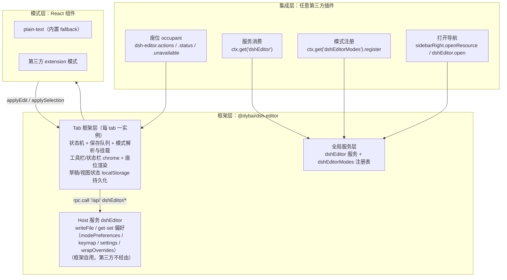
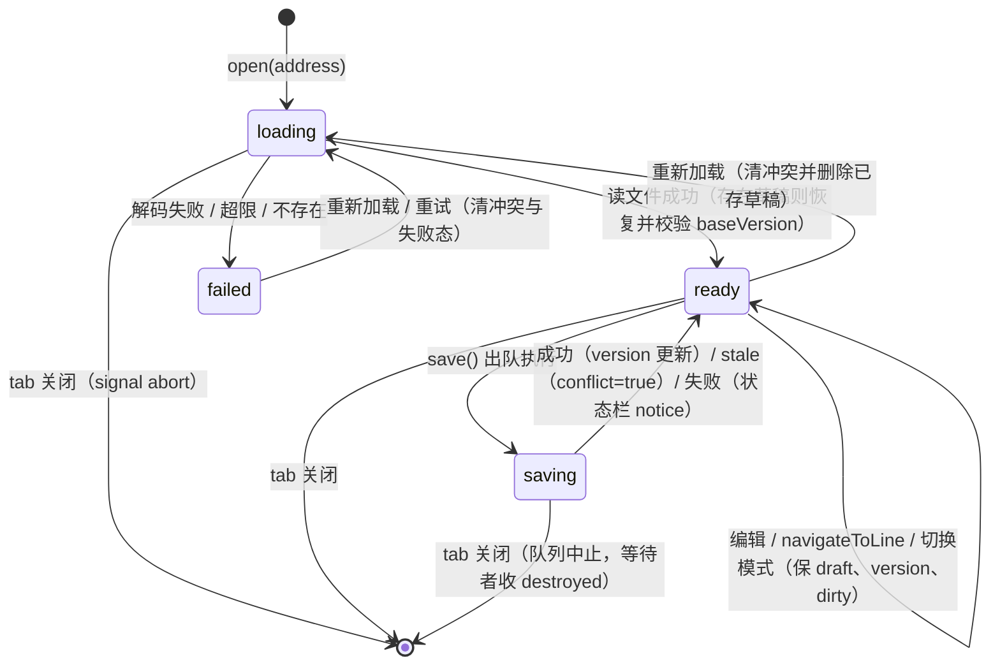
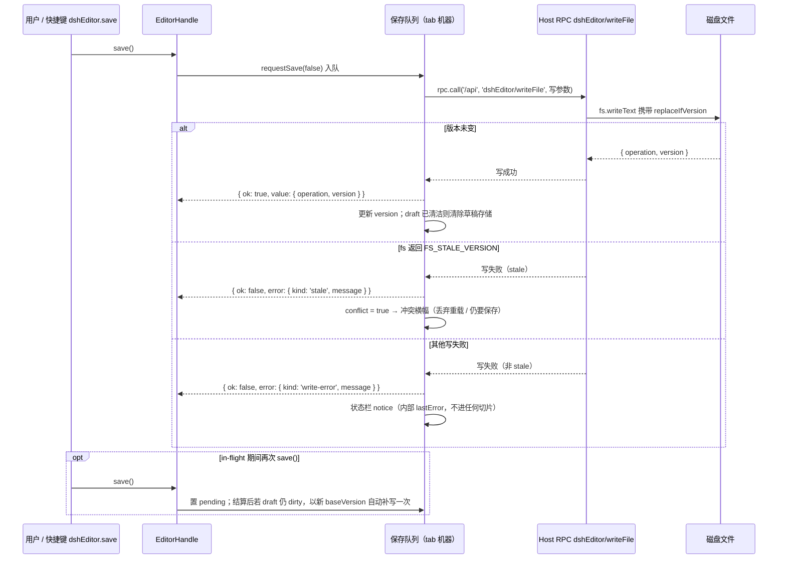

# DSH 编辑器框架 · 集成契约（`@dybai/dsh-editor`）

本文件是 `@dybai/dsh-editor` 对**第三方插件开发者**的集成契约，与 v0.2.0 实现逐一核对。阅读对象：想在编辑器上扩展 UI（座位）、消费编辑状态（服务）或提供新编辑模式（模式注册）的插件作者。

## 1. 契约变更记录

| 版本 | 契约增量 |
|---|---|
| 0.2.0 | 初版契约（本清单全部条目） |
| 0.3.0 | 外部修改/删除检测：§4.2 `state` 切片与 §3 status snapshot 新增 `external` 字段（additive）；§8 新增 `dshEditor/getSettings` / `dshEditor/setSettings` 端点与 §9 `settings` KV 表；框架开始占据宿主 `sidebar.right.pane.tab.title` 座位（同键派发，第三方若在该座位下以本框架 tab 类型 id 注册 occupant，将与框架的标题渲染共存/竞争，见 §3.1） |
| 0.4.0 | 活动行高亮：§5.1 描述符新增可选 `activeLine` 字段、模式组件 props 新增 `highlightActiveLine`（实时布尔，additive）；§8 `settings` 已知键新增 `highlightActiveLine`（默认 `true`）。内置 `plain-text` 模式以光标行上下双线标记当前行（不填背景，多行选区由原生选区样式呈现） |
| 0.5.0 | 行号列：模式组件 props 新增 `showLineNumbers`（实时布尔，additive；**无描述符声明字段**，不遵循的模式忽略该 prop 即可）；§8 `settings` 已知键新增 `showLineNumbers`（默认 `true`）。内置 `plain-text` 模式在内容左侧渲染行号列（宽度随最大行号位数自适应，随滚动与编辑实时同步）；分界竖线与预留带常驻——开关仅控制数字显隐，正文位置恒定 |
| 0.6.0 | 跳转到行：§6 自管键位新增第四动作 `gotoLine`（默认 `Ctrl+G`，可录制；§8 `keymap` 校验集合随之扩展）。跳转复用既有 `navigateToLine` 交付语义（§4.2），落点恒为目标行**行首**；UI 为状态栏左端的跳转面板（非契约面）。**键位存储迁移**（读取侧，additive）：旧版完整三动作存储在新模型下视为"缺 `gotoLine`"——已存键位原样保留，缺失动作按默认键 → 默认键+Shift → 默认键+Alt 候选链补位（`Ctrl+G → Ctrl+Shift+G → Ctrl+Alt+G`），全部候选被占用则放弃迁移保持默认；迁移不回写存储。`dshEditor/getKeymap` 读端不完整即拒绝的语义不变（`completeKeymap` 为客户端读取路径的迁移层） |
| 0.7.0 | 持久化诊断日志：Host RPC 新增第 8 端点 `dshEditor/appendLogs`（持久化插件诊断日志，additive，见 §8）；客户端日志通道升级（debug/info/warn/error，console 行为保持）；Host cordis exporter 持久化命名 logger `dsh-editor` 的记录；新 KV unit `dsh_editor_logs`（single layout，独立于既有 `dsh_editor` unit，见 §9） |
| 0.8.0 | 光标与视口位置恢复：模式组件 props 新增可选 `initialScroll` / `onScrollChange`（additive；无描述符声明字段，忽略安全，见 §5.5）；§9 新增 localStorage 单键 `dsh-editor.view-state`（按工作区根 + 文件路径记忆选区与滚动，LRU 200 条 / 90 天）。选区持久化/恢复由框架负责；内置 plain-text 直接获得光标恢复，第三方模式需按 §5.5 镜像机器选区并让可编辑元素取得焦点后可见 |
| 0.9.0 | 滚动越过最后一行——§5.1 组件 props 新增 `scrollBeyondLastLine`（实时布尔，additive；无描述符声明字段，忽略安全）；§8 `settings` 已知键新增 `scrollBeyondLastLine`（默认 `true`）。内置 `plain-text` 模式在内容末尾之后保留可滚动空白（`padding-bottom = 视口高度 − 行高`），最后一行可滚动到视口顶部 |
| 0.10.0 | 自动换行——§5.1 组件 props 新增 `wordWrap`（按当前文件解析的实时布尔：全局显式设置优先，未设置时按内置扩展名默认；additive；无描述符声明字段，忽略安全）；§8 `settings` 已知键新增 `wordWrap`（显式缺省值 `false`；未显式设置时按内置默认解析）。内置 `plain-text` 模式实现词边界折行，行号/高亮/跳转在折行下保持正确 |
| 0.11.0 | 设置中心与按类型换行——**纯 UI 演进 + 两处 additive 契约增量**。UI：状态栏齿轮打开应用级**单例模态**（`role="dialog"` 遮罩层，左分区菜单 + 右内容区；内部注册表内置四区：外观 / 行为 / 换行 / 快捷键），0.10.0 的逐 tab 设置浮窗与键位浮窗退役、键盘图标消失（键位录制整体迁入「快捷键」分区，录制态 Esc 只取消录制、不关闭对话框；状态栏入口收敛为齿轮）。设置中心为框架自用 UI，DOM/类名/分区注册表不属契约，第三方设置分区座位本期不开放。契约增量：§8 新增 `dshEditor/getWrapOverrides` / `dshEditor/setWrapOverrides` 端点对；§9 新增 `wrap_overrides` 表（record key = `*.<ext>` glob，value = `{ enabled, updatedAt }`，与既有三表共享同一全局 `updatedAt` 令牌）；`wordWrap` prop 的取值升级为**三层解析链**（命中的 per-glob 覆盖 > 全局显式 > 内置扩展名默认，prop 仍只送最终布尔）。跨窗口：任一偏好写成功后经 `BroadcastChannel`（通道名 `dsh-editor-prefs`；不可用时降级 localStorage 键 `dsh-editor-prefs-notify`）广播 store 名，其他窗口收到后重读全部四个偏好缓存，另有窗口聚焦/页面可见时的兜底刷新 |
| 0.12.0 | 空白字符显示——§5.1 组件 props 新增 `showWhitespace = { spaces, tabs, newlines }`（三个独立全局布尔，均默认 `false`；additive；无描述符声明字段，忽略安全）；§8 `settings` 已知键新增 `showWhitespaceSpaces` / `showWhitespaceTabs` / `showWhitespaceNewlines`（默认 `false`）；内置 `plain-text` 模式以窗口化字形层渲染 `·` / `→` / `↵`，不折行与折行模式下与正文对齐 |
| 0.13.0 | Tab 缩进与缩进设置——§8 `settings` 已知键新增 `indentMode`（`auto \| tabs \| spaces`，默认 `auto`）/ `indentWidth`（`2 \| 4 \| 8`，默认 `4`），§8 设置校验从「值全为 boolean」升级为**按键类型表**（两端同构，同包升级约束不变）；内置 `plain-text` 模式编辑区固定占用 Tab / Shift+Tab（缩进 / 反缩进，跨行整块，写入经 `execCommand('insertText')` 保留原生撤销，不可用时回退内容写命令）；键位录制器保留组合扩展：裸 Tab 与 Shift+Tab 拒绝录制；设置中心新增「缩进」分区（模式 + 宽度分段选择器）；行尾保留——§8 `writeFile` 语义变更：读入时探测文件 EOL（CRLF / LF / CR，混合按主导行尾），保存时把 LF 草稿还原为该行尾写盘（机内与显示层恒为 LF——textarea 约束）；新文件默认 LF；§4.2/§3 state 快照 additive 新增 `eol` 字段供行尾区分显示；wire 形状不变 |
| 0.14.0 | 竖线标尺：§8 `settings` 已知键新增 `showRuler`（boolean，默认 `false`）/ `rulerColumn`（1–999 整数，默认 `80`，首个数字型设置，按键类型表新增整数范围档，两端同构）；设置中心「外观」分区新增「标尺」分组（开关 + 自由数字输入行，`change`/Enter 提交、非法输入回退）；内置 `plain-text` 模式在正文之下绘制第 N 列字符格右缘的全高 1px hairline（几何列语义，随水平滚动平移，折行下恒固定列）；§5.1 组件 props 新增 `ruler = { enabled, column }`（additive，无描述符声明字段，忽略安全） |

后续每次发布必须在此登记"版本 → 契约增量"；废弃条目按 §10 演进流程标注"自 vX.Y 废弃"。

### 非契约声明

**DOM 结构与 `data-dsh-editor-*` 属性不是集成契约。** 根元素上的 `data-dsh-editor-address` / `data-dsh-editor-session` / `data-dsh-editor-visible`、输入框上的 `data-dsh-editor-input`、模式按钮上的 `data-dsh-editor-mode` 仅为调试标记，随时可能增删改名。第三方集成只依赖本文件列出的：座位名、owner props、服务 key、方法签名、RPC 端点、存储键——不要查询 DOM。

**设置中心是纯 UI 演进，不是契约面。** 自 0.11.0 起状态栏的**齿轮**是唯一设置入口：它打开一个应用级单例模态（`document.body` 下的遮罩 + 居中面板，左分区菜单 / 右内容区；四分区 = 外观 / 行为 / 换行 / 快捷键），0.10.0 的逐 tab 设置浮窗与键位浮窗退役。对话框的 DOM 结构、`dsh-editor-settings-dialog-*` 类名、分区注册表形态与分区内部渲染都不属集成契约；第三方设置分区座位本期不开放（后续按 §10 规则 5 additive 追加）。

## 2. 集成总览

三层职责：**集成层**（第三方，零依赖消费）→ **框架层**（本包，唯一状态与编排所有者）→ **模式层**（内容渲染 React 组件）。第三方集成零依赖：只依赖"名字"（座位名、服务 key、方法名），不 require 本包。



消费面一览：

| 契约面 | 入口 | 章节 |
|---|---|---|
| 座位 ×3 | `ctx.slots.inject('dsh-editor.*', …)` | §3 |
| 客户端服务 | `ctx.get('dshEditor')` | §4 |
| 模式注册表 | `ctx.get('dshEditorModes')` | §5 |
| 命令与快捷键 | 框架自管键位（根元素拦截）+ `ctx.shortcuts`（仅 `dshEditor.modeMenu`） | §6 |
| 导航契约 | `ctx.sidebarRight.openResource(…, { kind: 'editor' })` | §7 |
| Host RPC | `dshEditor/writeFile` 等（本框架自用） | §8 |
| 持久化 | Host storage + localStorage（草稿 / 视图状态，见 §9） | §9 |

## 3. 座位

三个座位均为编辑器 tab 主体（`sidebar.right.pane.tab` body）声明的子槽，`kind: 'list'`、`scope: 'session'`（每个会话独立渲染列表）。occupant 除 owner props 外还收到会话标准 props（`t`、`sessionId` 等），与向宿主预览工具栏注册完全同款。

| 座位名 | 渲染位置 | owner props |
|---|---|---|
| `dsh-editor.actions` | 工具栏：文件名/路径/模式指示器之后，未保存标记与"重新加载/保存"按钮之前 | `{ address, path, sessionId }` |
| `dsh-editor.status` | 状态栏：`Ln/Col · 行数 · 字符数` 元信息之后，notice 之前 | `{ address, path, sessionId, snapshot }` |
| `dsh-editor.unavailable` | 加载失败/不支持内容的空态，重试按钮旁 | `{ address, path, sessionId, failure }` |

owner props 字段：

- `address`：完整的 `dsh-resource://file/session/<sessionId>/<path>` 地址；
- `path`：解码后的 `/` 分隔路径；
- `sessionId`：所属会话 id；
- `snapshot`（仅 status）：**渲染时刻**的快照，字段见下表；
- `failure`（仅 unavailable）：失败 message 字符串，`string | null`（地址不支持时为本地化提示文本）。

`snapshot` 字段（与句柄 `state` 切片同相位语义）：

| 字段 | 类型 | 说明 |
|---|---|---|
| `phase` | `'loading' \| 'ready' \| 'failed'` | 保存中映射为 `ready`（配 `saving: true`） |
| `dirty` | `boolean` | 草稿与基线不同 |
| `saving` | `boolean` | 有写入在途 |
| `conflict` | `boolean` | 磁盘版本落后（冲突横幅显示中） |
| `external` | `'modified' \| 'deleted' \| null`（自 0.3.0） | 外部磁盘状态标记：`'deleted'` 在文件被外部删除后持久存在（页签红字删除线读取它），文件重建/保存重建/重新加载成功后清除；`'modified'` 仅在修改询问显示期间存在 |
| `eol` | `'lf' \| 'crlf' \| 'cr'`（自 0.13.0） | 文件主导行尾（读入探测，行尾保留的显示数据源）：空白字符显示据此绘制断行记号（CRLF = ␍+↵、CR = ␍、LF = ↵）；混合行尾按主导显示 |
| `caret` | `{ line, column }` | 1 起始光标行列 |
| `lineCount` | `number` | 行数（空文本为 1） |
| `chars` | `number` | 字符数 |

occupant 形态约束：`status` 座位请渲染**单行紧凑元素**（容器单行、溢出隐藏）；`actions` 座位请渲染 **26px 工具按钮级元素**（与工具栏自带按钮同高）。

最小注册示例：

```js
// 你的插件 apply(ctx) 内：向编辑器状态栏注册一个 occupant
ctx.slots.inject('dsh-editor.status', function* () {
	yield ctx.slots.register(
		{ name: 'dsh-editor.status', id: 'your-plugin-status', order: 10, locale: 'yourNs' },
		YourStatusChip
	);
});
```

### 3.1 tab 标题渲染（自 0.3.0）

本框架自 0.3.0 起在宿主座位 `sidebar.right.pane.tab.title` 下以本框架 tab 类型 id（`key = '@dybai/dsh-editor'`）注册标题 occupant：文件被外部删除期间（`state.external === 'deleted'`）页签文件名渲染为红色删除线，其余时候渲染与宿主默认回退相同的纯文件名。第三方**一般不应**在该座位下以同一 key 注册（会与本框架的标题渲染竞争，后注册者胜出）；需要自定义编辑器 tab 标题的集成请先与本框架协调（例如未来以 additive 方式开放组合渲染），不要依赖本条目之外的任何 DOM 形状。

### 3.2 外部磁盘状态语义（自 0.3.0）

框架为每个编辑器 tab 维护磁盘真相检测（Host `workspaceFiles/changes` 推送流，失败时降级为焦点触发的 `stat` 检查），并把策略结果放进状态：

- **外部修改**：草稿与基线**永不自动变更**——干净文件且设置 `autoReloadClean` 开启时静默重载，否则弹出浅黄询问条（重新加载 / 放弃更新 / 不再询问）。"不再询问"仅本 tab 生命周期有效；放弃更新后，同版本磁盘内容不再重复询问，之后的保存走既有 stale → 冲突横幅兜底（绝不静默覆盖）。
- **外部删除**：`state.external = 'deleted'` 持久标记（页签红字删除线）+ 询问条（关闭页签 / 保留）。保留后可继续编辑，**保存即重建**（写入不带版本意图，成功后清除标记）；外部重建同路径则标记清除并按外部修改处理。干净草稿同样可保存（按钮与 Ctrl+S 均可用，不要求先修改内容）：为防误重建，首次触发只**布防确认**——保存按钮变「确认重建」警示色、Ctrl+S 无副作用——再次触发才执行；任何编辑或外部状态变化自动解除布防。dirty 时保存直接重建，无确认。`saveAll` 仍跳过干净 tab（不批量重建）。
- 与既有冲突横幅的关系：两种提示不叠加——保存触发 stale 时，打开中的修改询问收进红色冲突横幅（其选项是超集）；`conflict` 期间不再弹新的修改询问。

## 4. 服务 `dshEditor`

`ctx.get('dshEditor')`（特性检测：返回值非 `undefined` 即可用）。消费者契约面：

```js
{
  version: '0.3.0',                                   // 包版本串
  active: { getSnapshot, subscribe },                 // 前台句柄 EditorHandle | undefined
  open(address, { line }?): void                      // 转发 openResource(kind:'editor')，见 §7
}
```

服务对象上另有 `registerTab` / `unregisterTab` / `saveAll` / `modeRegistryProxy` 等成员，属于**框架内部装配面**（本包 tab 组件与内置命令使用），不在第三方契约内，勿依赖。

### 4.1 `active` 前台句柄解析规则

`active` 是 `ObservableSnapshot<EditorHandle | undefined>`。取值语义：当前 on-screen 会话（sidebar-right 的可见会话）中，活动 tab 为本框架的 `kind: 'editor'` tab，且该地址存在**已注册且可见**的 tab 时，返回其句柄；否则 `undefined`。解析由框架订阅 sidebar-right 既有可观察源完成（注册变化、控制器发布、可见性翻转、会话切换都会触发重解析），第三方无需自行推导。同一前台身份重解析返回**同一句柄引用**（不误报变更）；无初始发布，先读 `getSnapshot()`。

### 4.2 `EditorHandle` 全形状

一个编辑器 tab 实例的短命 API 对象：

```js
{
  address: string, sessionId: string,                          // 只读标识
  content:   { getSnapshot, subscribe },   // → { text: string, dirty: boolean }
  selection: { getSnapshot, subscribe },   // → { start, end, lineStart, lineEnd, text } | null
  state:     { getSnapshot, subscribe },   // → { phase, saving, conflict, version, failure }
  mode:      { getSnapshot, subscribe },   // → { modeId: string | undefined }
  save(): Promise<{ ok: true, value } | { ok: false, error }>,  // 进本 tab 保存队列
  navigateToLine(line): boolean,                                 // 见下方相位门禁
  close(): void                                                  // 框架关闭该 tab
}
```

- 所有切片遵循 `ObservableSnapshot` 惯例 `{ getSnapshot(), subscribe(fn) }`，**引用稳定**（未变的切片不换引用，可直接接 React）。React 消费者用内建 `useSyncExternalStore` 获得真推送响应式；本框架不发布任何 hook（hooks 从不跨宿主契约）。
- `state` 切片：`phase: 'loading' | 'ready' | 'failed'`；`saving: boolean`；`conflict: boolean`；`version: string`（已知文件版本）；`failure: string | null`；`external: 'modified' | 'deleted' | null`（自 0.3.0，语义见 §3 snapshot 表——deleted 的持久红标、modified 的询问期标记）；`eol: 'lf' | 'crlf' | 'cr'`（自 0.13.0，文件主导行尾——行尾保留的显示数据源，additive）。
- `save()` 信封：成功 `{ ok: true, value: { operation: 'create' | 'update', version } }`；失败 `{ ok: false, error: { kind, message } }`，`kind` 取 `'stale'`（版本过期 → 冲突横幅）、`'write-error'`、`'not-ready'`（loading/failed 相位拒绝）、`'destroyed'`、`'cancelled'`（重新加载取消队列）之一。`save()` 从不抛异常。
- `navigateToLine(line)` 相位门禁：`ready`/`saving` 立即交付并返回 `true`；`loading` 挂起（最新请求获胜，`ready` 后交付一次）并返回 `true`；`failed` 返回 `false`。

### 4.3 生命周期语义

- **短命**：句柄由 tab 挂载时的注册支撑，tab 关闭/卸载即失效；同一 tab 重新挂载会铸造新句柄。
- **失效后明确错误**：句柄失效后各切片返回一份冻结的过期快照——`content` → `{ text: '', dirty: false }`、`selection` → `null`、`state` → `{ phase: 'failed', saving: false, conflict: false, version: '', failure: 'handle closed' }`、`mode` → `{ modeId: undefined }`；`save()` resolve `{ ok: false, error: { message: 'dsh-editor: handle closed' } }`、`navigateToLine` 返回 `false`、`close()` 为 no-op。**never-throw**：任何句柄方法都不向消费者抛裸异常。
- **`close()` 的会话边界**：`close()` 经 sidebarRight 关闭的是**前台会话**中的 tab；后台会话的编辑器句柄 `close()` 会降级为 no-op（框架日志可见；`sidebarRight.close(tabId)` 只作用于 on-screen Session 的 tab，公共面无 closeIn）。

### 4.4 响应式消费示例

```js
const handle = editor.active.getSnapshot(); // 前台句柄，可能 undefined（无前台编辑器）
if (handle === undefined) return null; // 无前台句柄：按你的 UI 降级（隐藏入口/提示）
const selection = useSyncExternalStore(handle.selection.subscribe, handle.selection.getSnapshot);
```

### 4.5 语义说明（与实现的刻意对应）

| 语义 | 说明 |
|---|---|
| `content.text` = 实时草稿 | 是正在编辑的当前文本，不是磁盘基线；`dirty` = 草稿 ≠ 基线 |
| `state.failure` = message 字符串 | 失效种类（`kind`）在切片中被丢弃，只保留人读的 `message`；种类信息仅存在于 `save()` 错误信封的 `error.kind` |
| `saving` 相位映射 | 内部状态机的 `saving` 相位在公共模型中表达为 `phase: 'ready'` + `saving: true` |
| `lastError` 不在切片中 | 保存失败 notice 是框架内部状态：错误只经 `save()` 的信封流向调用方，UI notice 由框架渲染在状态栏，不进入任何切片 |

## 5. 模式注册 `dshEditorModes`

`ctx.get('dshEditorModes')`。注册表 API：

```js
register(descriptor)  // → disposer；id 缺失或非非空字符串时抛错（唯一的主动抛错点）
entries()             // → readonly descriptor[]（注册顺序的浅拷贝）
subscribe(fn)         // → 退订函数；注册/注销时通知（无初始发布）
```

### 5.1 描述符字段表

| 字段 | 类型 | 必需 | 说明 |
|---|---|---|---|
| `id` | `string` | 是 | 实现唯一 id（非空字符串） |
| `priority` | `'extension' \| 'builtin' \| 'fallback'` | 否 | 排序带；未知或缺省按 `fallback` |
| `globs` | `readonly string[]` | 否 | 候选资格 + 特异性排序；也是菜单"设为默认"的写入来源（每个 glob 一条关联）。无 `globs` 视为 specificity 0（匹配所有路径但不参与特异性竞争） |
| `matches` | `(path: string) => boolean` | 否 | 否决谓词：返回 falsy 的候选被移出排序（pin/关联豁免，见 5.2） |
| `label` | `() => string` | 否 | 菜单显示名；抛错或返回非串时回退显示 `id` |
| `contentKind` | `'text' \| 'raw'` | 否 | v1 只实现 `'text'` 加载路径；`'raw'` 为契约预留，见 5.4 |
| `activeLine` | `boolean` | 否 | 自 0.4.0。声明本模式自行实现了「高亮光标所在行」并遵循 `highlightActiveLine` 偏好（经组件 prop 下发，见下行）；缺省视为不支持。高亮范围的数据源是快照 `selection.lineStart`/`lineEnd`（§5.5）。框架当前不因该字段改变行为——契约自描述，为后续「编辑区浮层座位」预留 |
| `component` | `ReactComponent` | 是* | 内容视图组件；props 为 `{ controller, t, address, path, sessionId, highlightActiveLine, showLineNumbers, initialScroll, onScrollChange, scrollBeyondLastLine, wordWrap, showWhitespace, indentSettings, ruler }`（`highlightActiveLine` 自 0.4.0：`highlightActiveLine` 偏好的实时布尔值，声明了 `activeLine` 的模式据此绘制/停用高亮；`showLineNumbers` 自 0.5.0：`showLineNumbers` 偏好的实时布尔值，支持行号的模式据此绘制/停用行号列；`initialScroll`（自 0.8.0：`{ top, left } \| null`，本次挂载要恢复的滚动偏移；管理自身滚动容器的模式应在内容就绪且可测量后应用一次）、`onScrollChange`（自 0.8.0：`(next: { top, left }) => void`，模式滚动变化时上报；忽略则不持久化该模式的滚动）；`scrollBeyondLastLine`（自 0.9.0：`scrollBeyondLastLine` 偏好的实时布尔值；管理自身滚动容器的模式可据此在内容末尾之后保留空白区域；未支持的模式安全忽略）；`wordWrap`（自 0.10.0：当前文件的有效换行偏好；管理自身折行的模式可据此对齐用户意图；未支持的模式安全忽略）；`showWhitespace`（自 0.12.0：`{ spaces, tabs, newlines }` 三旗标对象——三个空白字符偏好的实时布尔值，additive；无描述符声明字段，自行绘制空白字形的模式可据此渲染对应字形；未支持的模式安全忽略）；`indentSettings`（自 0.13.0：`{ indentMode, indentWidth }` 二字段对象——缩进模式（`auto \| tabs \| spaces`，`auto` 时按当前文件探测，无信号回退宽度值）与缩进宽度（`2 \| 4 \| 8`）的实时值，additive；无描述符声明字段，自行处理缩进的模式可据此对齐用户意图；未支持的模式安全忽略）；`ruler`（自 0.14.0：`{ enabled, column }` 二字段对象——`showRuler` 偏好的实时布尔与 `rulerColumn` 偏好的实时整数（1–999，默认 `80`）的当前值，additive；无描述符声明字段，恒以对象下发（开关关闭时也下发，`enabled` 为 `false`），自行绘制标尺的模式可据此在对应列定位竖线；未支持的模式安全忽略）；未支持的模式均可安全忽略）。解析结果无组件（或非函数）时框架回退内置 `plain-text` |

### 5.2 解析顺序与三带排序

对某文件路径的解析顺序：

1. **pin**：该 tab 的瞬态选择（"本次用 X 打开"），直接返回，**豁免 `matches` 否决**；
2. **持久化关联**：第一条 glob 命中的记录（数组序即优先序），同样豁免 `matches`；
3. **排序**：band（`extension` > `builtin` > `fallback`）→ glob 匹配串长度（最长者胜）→ 注册顺序（最早者胜）；
4. **`matches` 否决**：在排序遍历中移除返回 falsy 的候选。

无候选解析为 `undefined`（正常状态，框架以内置 `plain-text` 组件兜底渲染）。

### 5.3 glob 语义（minimatch 约定）

- 匹配锚定整条路径、**大小写不敏感**；
- `*` 匹配除 `/` 外的任意字符；`?` 匹配一个除 `/` 外的字符；
- **零段 `**`**：成段出现的 `**` 匹配零个或多个整段——尾部 `a/**` 同时命中 `a` 本身；前部/中部 `**/` 匹配零或多段前缀（`**/x` 命中 `x` 与 `a/b/x`）；
- 不被 `/` 包界的 `**` 退化为 `.*`；其余字符字面匹配。

### 5.4 `contentKind: 'raw'` 预留说明

v1 框架只实现 `'text'` 加载路径（整文件 UTF-8 读入、框架托管读写与保存编排）。`'raw'` 已在契约中定型但**不实现**：落地后框架将跳过文本加载，只托管文档句柄（version/conflict/保存编排），内容读写由模式自带传输完成，模式自报 dirty。在此之前声明 `'raw'` 的描述符不会被区别对待，请勿发布依赖该路径的模式。

### 5.5 模式义务与禁区

**义务**：渲染内容；每次编辑上报 `controller.applyEdit(text)`；每次选区变化上报 `controller.applySelection({ start, end, lineStart, lineEnd, text })`（折叠时 `text` 为 `null`）；响应 `controller.onNavigate(cb)` 行导航（认领时回调返回 `true`，首个认领者获胜）；卸载时释放资源（返回清理函数）。模式还须把框架写入的机器选区（如恢复、删行、模板写入后的 selection）镜像到自身内容视图；选区上报只覆盖用户交互，机器选区不会自动显示。模式还须在内容就绪且可见时让可编辑元素取得焦点（内置 `plain-text` 在首次 `ready` 时 focus）；否则机器选区只画高亮，光标不可见且输入不会进入编辑器。

**活动行契约**（自 0.4.0）：声明 `activeLine: true` 的模式额外承担——以 `highlightActiveLine` prop 为开关、以快照 `selection.lineStart`/`lineEnd`（选区触及的行；折叠选区即光标行）为高亮范围，自行绘制活动行高亮，框架不代绘（呈现形式由模式自定：内置纯文本模式为光标行上下双线）。未声明的模式忽略该 prop 即可；内置 `plain-text` 模式始终实现该能力。

**行号契约**（自 0.5.0）：**无描述符声明字段**——`showLineNumbers` prop 直接送达到每个挂载的模式组件，支持的模式据此绘制行号列（框架不代绘），不支持的模式忽略该 prop 即可；内置 `plain-text` 模式始终实现该能力（内容左侧列，宽随最大行号位数，滚动/编辑实时同步）。

**视口契约**（自 0.8.0）：**无描述符声明字段**——`initialScroll` / `onScrollChange` 直接送达到每个挂载的模式组件。选区持久化与恢复完全由框架经状态机完成，模式无需参与；管理自身滚动容器的模式可在内容就绪且可测量后应用 `initialScroll`，并在滚动时调用 `onScrollChange`。忽略二者只损失该模式的滚动恢复，光标恢复不受影响。内置 `plain-text` 实现该契约。选区恢复写入的是机器状态；第三方模式需按上文义务镜像机器选区并在可见就绪时让可编辑元素取得焦点，光标才会可见（内置 plain-text 已实现）。

**滚动越界契约**（自 0.9.0）：**无描述符声明字段**——`scrollBeyondLastLine` prop 直接送达到每个挂载的模式组件。开启时，管理自身滚动容器的模式可在内容末尾之后保留可滚动空白，使末行可滚动至视口顶部；具体呈现由模式自定，框架不代绘、不强制。不支持的模式忽略该 prop 即可，无任何影响；内置 `plain-text` 模式始终实现该能力。

**换行契约**（自 0.10.0，0.11.0 起为三层解析）：**无描述符声明字段**——`wordWrap` prop 直接送达到每个挂载的模式组件，取值是**当前文件的有效换行偏好**：命中的 per-glob 覆盖优先，其次用户显式存储的全局 `wordWrap`，最后内置扩展名默认（`md` / `markdown` / `mdx` 折行）（见 §8 / §9；prop 仍只送最终布尔，模式不感知层级）。是否折行、如何折行由模式自定，框架不代绘、不强制；不支持的模式忽略该 prop 即可，无任何影响。内置 `plain-text` 模式始终实现该能力：长行在词边界折行，折行下行号列、活动行高亮与 `Ctrl+G`/End 跳转落点保持精确。

**空白字符契约**（自 0.12.0）：**无描述符声明字段**——`showWhitespace` prop（`{ spaces, tabs, newlines }` 三旗标对象，实时值）直接送达到每个挂载的模式组件，三个开关相互独立、均默认关闭。是否绘制、如何呈现空白字形由模式自定，框架不代绘；不支持的模式忽略该 prop 即可，无任何影响；内置 `plain-text` 模式始终实现该能力——任一开关开启即挂载窗口化字形层（可视行 ±2 行缓冲），空格渲染 `·`（U+00B7），制表符渲染 `→`（U+2192）并补位到下一制表停位（4 列默认），逻辑行的行断在其**最后一个视觉行**行尾渲染 `↵`（U+21B5）；每个真实行断都渲染——含文件末尾的尾随换行（0.13.0 起，EOF 回车即时反馈）。字形进宽由 CSS 强制为一字宽，行 span 不自行折行——折行模式下的断行位置来自框架折行机器（`↵` 只落在逻辑行的最后一个视觉行），不折行与折行两种模式下字形均与正文逐行对齐。字形以标签色约 25% 不透明度着色（主题自适应），垫在正文之下——被选中文本内的字形由原生选区背景覆盖（v1 接受的取舍）。三个开关全关时字形层不挂载，零成本。

**竖线标尺契约**（自 0.14.0）：**无描述符声明字段**——`ruler` prop（`{ enabled, column }` 二字段对象，实时值）直接送达到每个挂载的模式组件：`enabled` 即 `showRuler` 偏好（默认关闭），`column` 即 `rulerColumn` 偏好（1–999 整数，默认 `80`）。是否绘制、画在哪一列由模式自定，框架不代绘；不支持的模式忽略该 prop 即可，无任何影响；内置 `plain-text` 模式始终实现该能力——在正文之下绘制第 `column` 列字符格右缘的全高 1px hairline：位置为纯几何列（行号带宽度 + 列号的 `ch` 偏移），Tab 展宽与全角字符不折算进列号，随水平滚动平移且经行号带之下不外露，折行模式下恒为固定列；prop `column` 不可解析时内置模式回退 `80`，越界数值收敛到 1/999 边界。开关关闭时标尺层不挂载，零成本。

**禁区**：**自行读写文件或实现保存**——I/O 与乐观并发全部在框架层；模式只经控制器读写内存态。**不得 `stopPropagation` keydown**——编辑器的自管键位（§6）依赖按键自模式组件冒泡到编辑器根元素，截断冒泡会使编辑器在其编辑区内失键。

框架 → 模式的写路径：`controller.onNavigate(cb)`（行导航）、`controller.setContent(content, selection?)`（框架内容写命令，如删行；模式经订阅镜像其结果）。焦点管理属宿主 UI 层，模式控制器不提供 focus 命令；模式自行决定何时聚焦其可编辑元素（见 §5.5 义务）。

模式组件最小示例（与内置 `plain-text` 同构；`h` 即 `React.createElement`）：

```js
function YourMode({ controller }) {
	const state = useSyncExternalStore(controller.subscribe, controller.getState);
	// 行导航：认领返回 true，框架停止向后续处理器投递
	React.useEffect(() => controller.onNavigate((line) => {
		// …滚动/置光标到 line…
		return true;
	}), [controller]);
	return h('textarea', {
		value: state.draft,
		onChange: (e) => controller.applyEdit(e.target.value),
		onSelect: () => {
			const { selectionStart: s, selectionEnd: e, value } = e.target;
			controller.applySelection({
				start: s,
				end: e,
				lineStart: lineOfOffset(value, s),
				lineEnd: lineOfOffset(value, e),
				text: s === e ? null : value.slice(s, e)
			});
		}
	});
}
```

### 5.6 生命周期状态机



- `loading` 由框架渲染（模式未挂载）；`failed` 渲染错误 + 重试按钮 + `dsh-editor.unavailable` 座位；
- **模式切换 = `ready` 自环**：框架保住 draft/version/dirty，卸旧挂新，交接无损；任意相位允许切换；
- **重新加载**（ready/failed 均可发起）：清冲突/失败态并删除已存草稿后重读；保存队列等待者收 `cancelled`；
- **tab 关闭/销毁**：机器停止发布，保存队列等待者收 `destroyed`；句柄随之失效（§4.3）；
- `save()` 仅 `ready`/`saving` 接受；`loading`/`failed` 拒绝并返回 `{ ok: false, error: { kind: 'not-ready', … } }`。

## 6. 命令与快捷键

编辑器的四条框架动作 **不再走 `ctx.shortcuts`**，它们是**框架自管键位**（self-managed keymap）：编辑器 tab 的**根元素**拦截 keydown（命中组合即 `preventDefault`）——页面层的 `preventDefault` 对**任何组合**都有效，DSH web 运行时对浏览器保留组合的白名单限制在此通道**不适用**，自然键位因此回归。键位作用域 = 编辑器根元素之内；编辑器之外浏览器默认行为照旧。

| 动作 | 默认键 | 派发语义 |
|---|---|---|
| `save` | `Ctrl+S`（`{ code: 'KeyS', modifiers: ['primary'] }`） | 命中即 `preventDefault`；前台编辑器 dirty 且 ready/saving → 入保存队列；无修改或未就绪 → no-op（组合仍被压制，浏览器"保存网页"不触发） |
| `saveAll` | `Ctrl+Shift+S`（`['primary','shift']` + `KeyS`） | 命中即 `preventDefault`；当前会话内每个 dirty 且 ready/saving 的已注册编辑器逐个 `requestSave(false)` |
| `deleteLines` | `Ctrl+D`（`['primary']` + `KeyD`） | 命中即 `preventDefault`；前台编辑器 ready/saving → 删除光标行/选区触及行（框架内容模型计算，经 `controller.setContent` 下发）；否则 no-op |
| `gotoLine`（自 0.6.0） | `Ctrl+G`（`['primary']` + `KeyG`） | 命中即 `preventDefault`；打开状态栏左端的跳转到行面板（输入为空、自动聚焦；Enter / 「跳转」按钮经 `parseGotoLine` 解析——越界收敛到 `1–总行数`，空/非数字给内联提示不跳转——再经 `controller.requestNavigate` 交付，落点恒为目标行行首）；面板已开时再按则重聚焦输入框；无控制器或 `failed` 相位退避（组合仍被压制） |

自管键位的规则与边界：

- **拦截层**：监听器挂在编辑器 tab 根元素（React `onKeyDown`），事件自模式组件冒泡而至；`isComposing`（输入法组合中）一律放行，不匹配任何动作的按键不干预（浏览器默认照旧）；
- **修饰键模型**：绑定记录 `code`（`Key<A-Z>` / `Digit<0-9>`）与 `modifiers`（`primary | control | alt | shift | meta` 的子集）；`primary` 在 web 运行时解析为 `ctrlKey`（macos 为 `metaKey`）。事件修饰键集合须与绑定**完全一致**（多按一个修饰键不算命中）；
- **配置入口**（0.11.0 起）：状态栏右端的**齿轮**按钮 → 打开设置中心的「快捷键」分区（键位面板从 0.10.0 的独立浮窗迁入单例模态；状态栏小键盘图标已退役，齿轮是唯一设置入口）。四行（保存 / 保存全部 / 删行 / 跳转到行）各显示当前组合 +「录制」按钮（点击进入录制态，捕获下一个 keydown → 写入 Host 存储 → 本地立即生效，所有已挂载编辑器同刷）；录制允许除浏览器保留组合外的任何组合（含 Ctrl+S 本尊——根元素拦截 + preventDefault 会压制浏览器默认）；**浏览器生命周期保留组合（Ctrl/⌘+W/T/N/Q、Ctrl+Tab、Ctrl+PageUp/PageDown 及其 +Shift 变体）录制时会被拒绝并给出可见提示**——页面层无法可靠拦截这类浏览器默认行为（Ctrl+W 会直接关闭页签），分区底部也常驻一行弱化提示说明此事；录制态按 `Escape` 取消——录制态的捕获层优先吞掉 `Escape`，**只取消录制、不关闭设置中心**（非录制态下 `Escape` 关闭对话框）；分区尾部「恢复默认」把四个动作写回默认组合（Ctrl+S / Ctrl+Shift+S / Ctrl+D / Ctrl+G）；
- **存储**：键位是**全局用户偏好**（跨 tab、跨模式一致），经 Host RPC `dshEditor/getKeymap` / `dshEditor/setKeymap` 持久化（§8），KV unit 的 `keymap` 表与模式关联、设置、换行覆盖表**共享同一个 `updatedAt` 令牌**（一张表的写入会使其他表基于旧令牌的 CAS 写失败，客户端重读后重试）；读取端对缺动作的旧版存储走 `completeKeymap` 迁移补位（见 §1 0.6.0 行）——已存键位永不因升级静默重置，迁移只发生在读取侧、不回写存储；
- **模式义务（新增）**：模式组件**不得 `stopPropagation` keydown**——自管键位依赖事件冒泡到编辑器根元素，截断冒泡会使编辑器在其编辑区内失键；`preventDefault` 亦不要对修饰键组合调用；
- **`ctx.shortcuts` 注册面**：本框架现仅注册一条命令 `dshEditor.modeMenu`（无默认键，用户可在宿主快捷键设置中自绑；前台编辑器存在 → 打开模式菜单）。宿主 shortcuts 服务的白名单、conflicts 表、设置页语义对 modeMenu 照常适用。

## 7. 导航契约

第三方把文件送进编辑器的唯一契约入口：

```js
// 标准形态（sidebar-right 契约）
ctx.sidebarRight.openResource(address, { kind: 'editor', params: { file: { line } } });

// 便捷形态（本框架服务，内部转发上面的调用）
editor.open(address, { line });
```

- `address`：`dsh-resource://file/session/<sessionId>/<path>` 会话文件地址；
- `line`：可选，1 起始行号；非有限数值被忽略，`< 1` 不生效。定位经 `navigateToLine` 相位门禁交付（§4.2）；
- `open()` 永不抛错、不校验地址（导航裁决属 sidebar-right）；
- 编辑器 tab 类型 `kind: 'editor'` **不声明 patterns**——文件只经显式导航进入（自带"编辑"按钮走同一契约）；`canOpen` 仍只放行会话范围内、按扩展名/文件名判定的文本文件。

## 8. Host RPC

命名空间 `dshEditor`，经 Client 通用网关通道 `connection.rpc.call('/api', 'dshEditor/<method>', { args }, signal)` 调用。**此面为本框架自用**（读取/保存/模式偏好），第三方插件无需也不应直接调用；列出以完整披露线上形状。

| 端点 | args | result |
|---|---|---|
| `dshEditor/writeFile` | `{ workspaceFileScopeId, path, content, baseVersion }` | `{ operation: 'create' \| 'update', version }` |
| `dshEditor/getModePreferences` | `{}` | `{ associations: [{ glob, modeId }]（按 glob 排序）, updatedAt }` |
| `dshEditor/setModePreferences` | `{ associations, expectedUpdatedAt? }` | `{ updatedAt }` |
| `dshEditor/getKeymap` | `{}` | `{ bindings: [{ action, code, modifiers }]（按 action 排序）, updatedAt }` |
| `dshEditor/setKeymap` | `{ bindings, expectedUpdatedAt? }` | `{ updatedAt }` |
| `dshEditor/getSettings`（自 0.3.0） | `{}` | `{ settings: { [name]: boolean \| 'auto' \| 'tabs' \| 'spaces' \| 2 \| 4 \| 8 \| 1–999 的整数 } }（仅含已存储项）, updatedAt }` |
| `dshEditor/setSettings`（自 0.3.0） | `{ settings, expectedUpdatedAt? }` | `{ updatedAt }` |
| `dshEditor/getWrapOverrides`（自 0.11.0） | `{}` | `{ overrides: [{ glob, enabled }]（按 glob 排序）, updatedAt }` |
| `dshEditor/setWrapOverrides`（自 0.11.0） | `{ overrides, expectedUpdatedAt? }` | `{ updatedAt }` |
| `dshEditor/appendLogs`（自 0.7.0） | `{ entries }`（1–200 条；每条 `{ ts, level, source: 'client', scope, text }`，约束见语义说明） | `{ accepted }`（降级时 `accepted: 0` 仍 resolve） |

语义说明：

- **乐观并发**：`writeFile` 携带读取时的 `baseVersion`，Host 侧以 `replaceIfVersion` 意图写盘；`baseVersion` 为空串 = 无版本意图写（"仍要保存"）。版本过期返回 `FS_STALE_VERSION` 类错误；写上限 4 MB、含 NUL 字节拒绝。写入按**所属会话**的沙箱策略裁决。**行尾保留（自 0.13.0）**：客户端读入时探测文件行尾（CRLF / LF / CR，混合按主导），机内草稿与基线恒为 LF，保存时 `content` 按探测到的行尾还原后写盘——CRLF/CR 文件经「打开→编辑→保存」不再被改写为 LF；新文件默认 LF。wire 形状不变，第三方无感知。
- **stale 语义（客户端）**：机器以 `/stale/i` 匹配错误码/消息判定版本过期 → `conflict = true` + 冲突横幅（"重新加载并丢弃本地修改" / "仍要保存（覆盖磁盘）"），草稿保留；非 stale 写失败只进状态栏 notice。
- **设置并发**（自 0.3.0）：`setSettings` 为完整集替换（缺失设置删除；`{}` 即恢复默认）+ `expectedUpdatedAt` 乐观锁（与模式关联、键位、换行覆盖**共用同一个全局 `updatedAt` 令牌**）；不匹配拒绝并返回 `settings/conflict`（客户端重读后提示重试）；payload 键必须全部是本构建已知设置名且值符合按键类型表（既有键布尔；`indentMode` ∈ `auto|tabs|spaces`；`indentWidth` ∈ `2|4|8`；`rulerColumn` ∈ 1–999 整数），否则 `settings/invalid`（当前已知：`autoReloadClean`，默认 `false`——干净文件被外部修改时静默重载而不询问；`highlightActiveLine`，自 0.4.0，默认 `true`——在光标/选区触及行背后绘制活动行高亮，经模式组件 prop 下发；`showLineNumbers`，自 0.5.0，默认 `true`——在内容左侧显示行号列，经模式组件 prop 下发；`scrollBeyondLastLine`，自 0.9.0，默认 `true`——在内容末尾之后保留可滚动空白，最后一行可滚动到视口顶部，经模式组件 prop 下发；`wordWrap`，自 0.10.0，显式缺省 `false`——未显式设置时按内置扩展名默认解析（`md`/`markdown`/`mdx` 默认开启），自 0.11.0 起被命中的 per-glob 覆盖优先于它，经模式组件 prop 下发最终有效值；`showWhitespaceSpaces` / `showWhitespaceTabs` / `showWhitespaceNewlines`，自 0.12.0，默认 `false`——三键独立，任一开启即在内置纯文本模式渲染对应空白字形（空格 `·` / 制表符 `→` 补位到停位 / 行断 `↵`），经模式组件 prop `showWhitespace` 下发；`indentMode`，自 0.13.0，默认 `auto`——`auto` 时按文件探测（前导 Tab → 制表符；否则最频前导空格宽度；无信号回退 `indentWidth`）；`indentWidth`，自 0.13.0，默认 `4`——空格模式宽度与探测回退宽度；`showRuler`，自 0.14.0，默认 `false`——开启时在编辑区指定列绘制竖线标尺，经模式组件 prop `ruler` 下发；`rulerColumn`，自 0.14.0，默认 `80`——竖线所在列号（1–999 整数，首个数字型设置），经模式组件 prop `ruler` 下发）。未知设置名会被读取端忽略（前向兼容更新版本的宿主）。**注意版本锁定**：设置写为完整集替换，已知键集合随构建共同演进——新客户端对旧宿主的**任何**设置写（含旧键）都会被 `settings/invalid` 拒绝，客户端与宿主两端必须同包升级（同一 npm 包发布）。
- **偏好并发**：`setModePreferences` 为完整集替换（缺失记录删除）+ `expectedUpdatedAt` 乐观锁；不匹配时拒绝并返回 `mode-preferences/conflict`，存储不动（客户端重读后提示重试）；无效 payload 返回 `mode-preferences/invalid-associations`，同样不落盘。Host 侧写操作经内部写链串行。
- **键位并发**：`setKeymap` 同为完整集替换 + `expectedUpdatedAt` 乐观锁（`keymap/conflict` / 无效 payload `keymap/invalid`）；`bindings` 须为非空、action 唯一（`action ∈ {save, saveAll, deleteLines, gotoLine}`）、`code` 匹配 `Key<A-Z>|Digit<0-9>`、`modifiers` ⊆ `{primary, control, alt, shift, meta}` 且组合不重复的数组。**四张偏好表共享同一个全局 `updatedAt` 令牌**：一次 keymap 写入会使携带旧令牌的 `setModePreferences` / `setSettings` / `setWrapOverrides`（或反之）以冲突拒绝——客户端在冲突路径自动重读并提示重试，不会丢写。
- **换行覆盖并发**（自 0.11.0）：`setWrapOverrides` 为完整集替换（缺失记录删除；`[]` 即清除全部按类型覆盖）+ `expectedUpdatedAt` 乐观锁（与另三表共享同一全局令牌）；令牌不匹配拒绝 `wrap-overrides/conflict`、存储不动（客户端重读后提示重试）；payload 须为条目数组，每项 `{ glob, enabled }`——`glob` 必须匹配 `/^\*\.[a-z0-9]{1,16}$/`（单段 `*` + 点 + 1–16 位小写字母/数字扩展名；本期不支持任意 minimatch glob）、`enabled` 必须为 boolean、同一 glob 不得重复，否则拒绝 `wrap-overrides/invalid`，同样不落盘。`getWrapOverrides` 按 glob 字典序返回完整集。命中多条规则时由客户端解析端裁决：**任一 `enabled: true` 命中即折行**，命中的全为 `false` 则不折行，无命中落回全局显式/内置默认（§5.5 三层链）；解析端对存储中手改出的非 `*.<ext>` 形态跳过（防御），写入端的严格校验不变。
- `updatedAt` 在首次成功写入前为 `0`；`getKeymap` 在首次写入前返回空 `bindings`（客户端回退内置默认键表）。
- **诊断日志**（自 0.7.0）：`appendLogs` 为 fire-and-forget（客户端不以结果做功能决策）；结构违规拒绝 `logs/invalid`（防坏数据入库；客户端预校验，正常路径不触发）；存储后端不可用时 Host 永久降级 resolve `{ accepted: 0 }`；手动清空方式 = 停用 DSH 后删除 `~/.dsh/storages/dsh_editor_logs.json`；轮转：条目上限 2000（chunk 粒度）+ 7 天陈龄 + 单条 2000 字符截断。

### 8.1 保存时序



## 9. 持久化

| 状态 | 介质 | 写时机 | 清除时机 |
|---|---|---|---|
| 模式关联 | **Host storage**（KV unit，经 RPC 桥） | 菜单"设为默认" / "恢复默认" | "恢复默认"删除命中当前路径的关联记录 |
| 编辑器自管键位 | **Host storage**（同一 KV unit 的 `keymap` 表，经 RPC 桥） | 设置中心「快捷键」分区「录制」/「恢复默认」 | 「恢复默认」写回默认组合（Ctrl+S / Ctrl+Shift+S / Ctrl+D / Ctrl+G） |
| 行为设置 | **Host storage**（同一 KV unit 的 `settings` 表，经 RPC 桥；自 0.3.0） | 设置中心「外观」/「行为」/「换行」分区切换开关 | 切回默认（写回该设置的默认值；完整集替换删除未包含的记录） |
| 按类型换行覆盖 | **Host storage**（同一 KV unit 的 `wrap_overrides` 表，经 RPC 桥；自 0.11.0） | 设置中心「换行」分区的「本类型换行」三态循环（跟随全局 / 强制开 / 强制关） | 循环回「跟随全局」删除该 `*.<ext>` 记录（完整集替换删除未包含的记录） |
| 插件诊断日志 | **Host storage**（KV unit `dsh_editor_logs`，`~/.dsh/storages/dsh_editor_logs.json`，经 RPC 桥） | 防抖 5s / 满 50 条 / 页面隐藏时批量 flush | 轮转自动淘汰（2000 条 / 7 天） |
| 未保存草稿 | **localStorage** 单键 `dsh-editor.draft` | 每次编辑（debounce 500ms） | 保存成功 / 显式重新加载 / LRU 50 条溢出 / 14 天过期 |
| 光标与视口位置 | **localStorage** 单键 `dsh-editor.view-state` | 选区变化（同步内存）/ 滚动（每次事件），500ms 防抖落盘；页面隐藏时 flush | LRU 200 条 / 90 天过期；保存/重新加载/关闭不清除 |
| tab 布局 | sidebar-right 自带 | 宿主 | 宿主 |
| 快捷键绑定 | shortcuts 服务自带 | 用户改键 | 宿主 |
| 保存/冲突/外部标记进行时状态 | 不持久化 | — | — |

- **偏好 KV unit 形状**：`{ name: 'dsh_editor', version: 1, tables: ['mode_associations', 'keymap', 'settings', 'wrap_overrides'], hasGlobal: true }`（unit 与表名均须满足 DSH 存储契约 `UNIT_NAME_RE = /^[a-z][a-z0-9_]*$/`）。`mode_associations` 记录 key = glob，value = `{ modeId, updatedAt }`；`keymap` 记录 key = action id（`save` / `saveAll` / `deleteLines` / `gotoLine`），value = `{ code, modifiers, updatedAt }`；`settings`（自 0.3.0）记录 key = 设置名，value = `{ value, updatedAt }`；`wrap_overrides`（自 0.11.0）记录 key = `*.<ext>` glob，value = `{ enabled, updatedAt }`——空集表示「无覆盖」，解析落回全局显式/内置默认；全局单例存集合级 `updatedAt`，作为**四表共用**的乐观锁令牌（任一表的完整集写入即刷新）。unit 惰性打开（首次使用时，打开结果记忆化），Host 半 effect 清理时关闭。
  - **0.11.0 加表不升 `version`**：`json` 后端只校验 unit 名与表名，`version` 不参与校验；已存文档缺 `wrap_overrides` 时读为空，下一次完整集写入按全量重写并保留既有三表的记录。升 `version` 反而会让既有 unit 打不开（数据丢失），因此保持 `version: 1`。
  - **降级风险（同包升级要求）**：unit 名/版本保持不变，因此 **0.11.0 之前的宿主能打开同一 unit**——但它不认识 `wrap_overrides`，其下一次 whole-unit 写入会把该表整表丢弃（Host 全量重写语义）。所以 0.11.0 的客户端与宿主必须同包升级（与 §8「版本锁定」同一约束）；只换一侧时先停用编辑器或避免写入偏好，待两端一致后再用。
- **诊断日志 KV unit 形状**（自 0.7.0）：独立 unit `{ name: 'dsh_editor_logs', version: 1, tables: ['chunks'], hasGlobal: true }`（unit 与表名同样满足 DSH 存储契约 `UNIT_NAME_RE = /^[a-z][a-z0-9_]*$/`）。`chunks` 记录 key = `'c'` + 单调 seq 的零填充定宽串（字典序 = 数值序，键永不复用），value = `{ seq, ts, entries }`；全局单例存 `{ lastSeq }` 游标。隐私口径——日志明文含文件路径/内容片段，落用户本机 `~/.dsh`，与草稿 localStorage 隐私提示一致。
- **草稿存储形状**：单键 `dsh-editor.draft`，JSON map；键 `"<sessionId>|<address>"`，value `{ text, baseVersion, savedAt }`。写入失败静默降级（内存态保持权威，下次成功写修复持久性）。隐私提示：localStorage 明文保存未保存内容，与 Web 编辑器通行做法一致。
- **草稿恢复语义**：读文件成功进入 `ready` 时，若存在已存草稿则恢复之；且 `stored.baseVersion !== 当前 version` 时置 `conflict = true`——冲突横幅先于任何保存出现，绝不静默覆盖新读内容。
- **视图状态存储形状**（自 0.8.0）：单键 `dsh-editor.view-state`，JSON map；键 = 工作区根 + 文件路径（Windows 盘符/UNC 大小写无关；cwd 未知时降级 `session:<id>/<path>`），value `{ selection: { start: { line, column }, end: { line, column } } | null, scrollTop, scrollLeft, savedAt }`。隐私提示：明文包含工作区/文件路径与光标行列，不落文件内容，仅存本机。
- **视图状态恢复语义**（自 0.8.0）：文件进入 `ready` 后，若存在记录则把选区按当前文本行列收敛到有效范围后经 `applySelection` 恢复；滚动由模式在可测量后应用。带显式 navigation 行（`params.file.line`）的打开抑制恢复、该行优先；其余打开若存在记录即恢复；无记录时无从恢复；内容变短只收敛、不做锚点迁移。
- **flush-on-hide**：草稿与视图状态写入均有 500ms debounce；页面隐藏（`visibilitychange → hidden`）、`beforeunload`、`pagehide` 时立即 flush 两个 store，压缩崩溃丢字/丢位置窗口。
- **可替换性**：Client 只依赖 §8 列出的 RPC 端点名与两个 localStorage 键（`dsh-editor.draft` / `dsh-editor.view-state`）；更换通道实现不改契约。

## 10. 演进规则

1. **命名即承诺**：已发布的座位名/属性名/方法名/端点名永不原地改名；改名 = 新名字 + 废弃窗口。
2. **Additive-only**：owner props/快照/描述符/RPC 参数只增不改；消费者应容忍多余字段、只读所需。
3. **废弃流程**：本文件相应条目标注"自 vX.Y 废弃"→ 保留 ≥ 1 个 minor 周期 → 仅 major 移除。
4. **能力探测双轨**：`dshEditor.version` 判版本 + 特性检测（`typeof handle.someNewMethod === 'function'`）判能力。
5. **新能力全部 additive**：`contentKind: 'raw'` 路径、fs 字节写桥接、关联管理设置页等均以新增字段/端点落地，不改既有形状（光标恢复已于 0.8.0 以此方式落地）。
6. **座位名不做版本前缀**（REST 式 `/v1/` 否决）：槽位渲染是加法，两代座位并存 = 两代 UI 同屏；各契约面独立演进，全局版本计数器粒度错误。破坏性变更逃生舱 = 届时一次性新命名面 + 旧面废弃窗口。

**自由改名窗口已关闭**：框架定义阶段的免费改名（`dshEditorFiles → dshEditor`）已随本契约冻结完成；此后任何命名变更走规则 1/3 的废弃流程。变更请在本文件顶部"契约变更记录"登记（规则：每次发布必填）。

## 11. 集成指南（FLR 型消费者三步集成）

以"选中行 → @引用"类消费者（读取编辑选区、生成引用文本）为例，全部集成三步完成，零依赖。

### 第一步：注册座位（可选，纯 UI 扩展）

```js
// apply(ctx) 内：在编辑器工具栏放一个按钮
ctx.slots.inject('dsh-editor.actions', function* () {
	yield ctx.slots.register(
		{ name: 'dsh-editor.actions', id: 'your-plugin-action', order: 10, locale: 'yourNs' },
		YourActionButton // owner props: { address, path, sessionId }
	);
});
```

### 第二步：消费服务选区

```js
const editor = ctx.get('dshEditor'); // 特性检测：undefined 表示本框架未安装
const handle = editor.active.getSnapshot(); // 前台句柄，可能 undefined（无前台编辑器）
if (handle === undefined) return; // 无前台句柄：按你的场景降级
// React 组件内一行接入推送响应式：
const selection = useSyncExternalStore(handle.selection.subscribe, handle.selection.getSnapshot);
// selection = { start, end, lineStart, lineEnd, text } | null → 据此生成行引用
```

### 第三步：注册模式（可选，内容视图扩展）

```js
const modes = ctx.get('dshEditorModes');
const dispose = modes.register({
	id: 'your-mode',
	priority: 'extension',
	globs: ['*.your-ext', 'data/**'],
	label: () => 'Your Mode',
	contentKind: 'text',
	component: YourMode // props: { controller, t, address, path, sessionId }，义务见 §5.5
});
// 你的插件停用时注销：dispose()
```

打开文件到编辑器用 §7 导航契约（`editor.open(address, { line })`）。

### 粒度阶梯

v1 开放的集成粒度是**完整模式**：一个接管整个编辑区渲染的 React 组件（§5）。更细的面——编辑区浮层座位（find/minimap）、fs 字节写 facet、模式关联管理设置页——随富模式落地按 §10 规则 5 additive 开放，当前均为已知的 v0.2 非目标。
