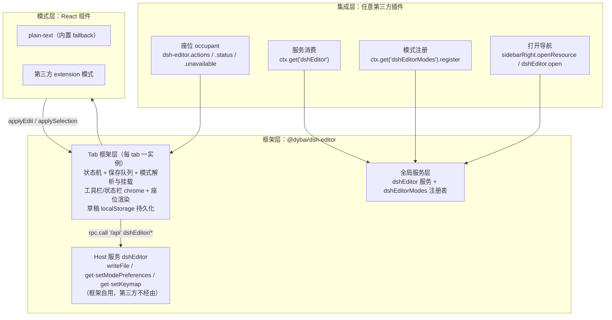
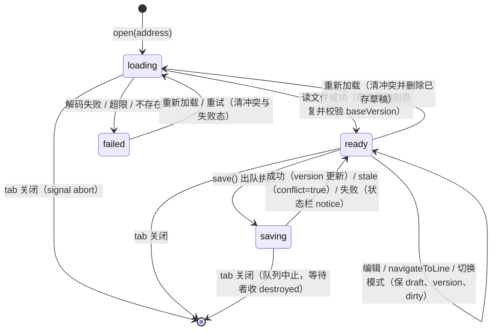
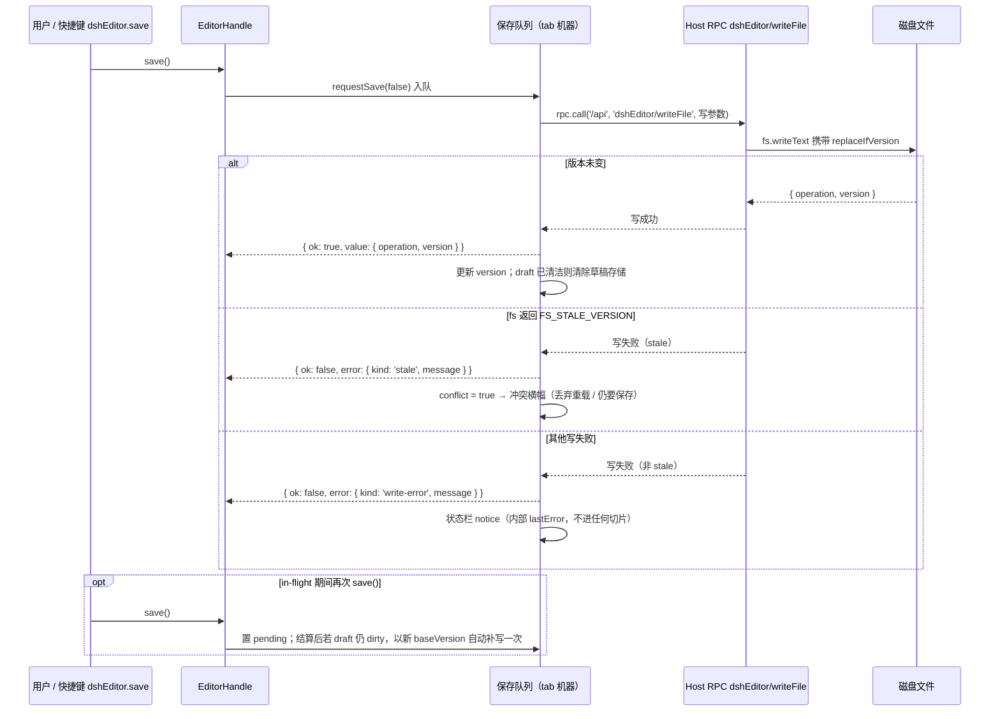

# DSH 编辑器框架 · 集成契约（`@dybai/dsh-editor`）

本文件是 `@dybai/dsh-editor` 对**第三方插件开发者**的集成契约，与 v0.2.0 实现逐一核对。阅读对象：想在编辑器上扩展 UI（座位）、消费编辑状态（服务）或提供新编辑模式（模式注册）的插件作者。

## 1. 契约变更记录

| 版本 | 契约增量 |
|---|---|
| 0.2.0 | 初版契约（本清单全部条目） |

后续每次发布必须在此登记"版本 → 契约增量"；废弃条目按 §10 演进流程标注"自 vX.Y 废弃"。

### 非契约声明

**DOM 结构与 `data-dsh-editor-*` 属性不是集成契约。** 根元素上的 `data-dsh-editor-address` / `data-dsh-editor-session` / `data-dsh-editor-visible`、输入框上的 `data-dsh-editor-input`、模式按钮上的 `data-dsh-editor-mode` 仅为调试标记，随时可能增删改名。第三方集成只依赖本文件列出的：座位名、owner props、服务 key、方法签名、RPC 端点、存储键——不要查询 DOM。

## 2. 集成总览

三层职责：**集成层**（第三方，零依赖消费）→ **框架层**（本包，唯一状态与编排所有者）→ **模式层**（内容渲染 React 组件）。第三方集成零依赖：只依赖"名字"（座位名、服务 key、方法名），不 require 本包。



消费面一览：

| 契约面 | 入口 | 章节 |
|---|---|---|
| 座位 ×3 | `ctx.slots.inject('dsh-editor.*', …)` | §3 |
| 客户端服务 | `ctx.get('dshEditor')` | §4 |
| 模式注册表 | `ctx.get('dshEditorModes')` | §5 |
| 命令与快捷键 | 框架自管键位（根元素拦截）+ `ctx.shortcuts`（仅 `dshEditor.modeMenu`） | §6 |
| 导航契约 | `ctx.sidebarRight.openResource(…, { kind: 'editor' })` | §7 |
| Host RPC | `dshEditor/writeFile` 等（本框架自用） | §8 |
| 持久化 | Host storage + `localStorage['dsh-editor.draft']` | §9 |

## 3. 座位

三个座位均为编辑器 tab 主体（`sidebar.right.pane.tab` body）声明的子槽，`kind: 'list'`、`scope: 'session'`（每个会话独立渲染列表）。occupant 除 owner props 外还收到会话标准 props（`t`、`sessionId` 等），与向宿主预览工具栏注册完全同款。

| 座位名 | 渲染位置 | owner props |
|---|---|---|
| `dsh-editor.actions` | 工具栏：文件名/路径/模式指示器之后，未保存标记与"重新加载/保存"按钮之前 | `{ address, path, sessionId }` |
| `dsh-editor.status` | 状态栏：`Ln/Col · 行数 · 字符数` 元信息之后，notice 之前 | `{ address, path, sessionId, snapshot }` |
| `dsh-editor.unavailable` | 加载失败/不支持内容的空态，重试按钮旁 | `{ address, path, sessionId, failure }` |

owner props 字段：

- `address`：完整的 `dsh-resource://file/session/<sessionId>/<path>` 地址；
- `path`：解码后的 `/` 分隔路径；
- `sessionId`：所属会话 id；
- `snapshot`（仅 status）：**渲染时刻**的快照，字段见下表；
- `failure`（仅 unavailable）：失败 message 字符串，`string | null`（地址不支持时为本地化提示文本）。

`snapshot` 字段（与句柄 `state` 切片同相位语义）：

| 字段 | 类型 | 说明 |
|---|---|---|
| `phase` | `'loading' \| 'ready' \| 'failed'` | 保存中映射为 `ready`（配 `saving: true`） |
| `dirty` | `boolean` | 草稿与基线不同 |
| `saving` | `boolean` | 有写入在途 |
| `conflict` | `boolean` | 磁盘版本落后（冲突横幅显示中） |
| `caret` | `{ line, column }` | 1 起始光标行列 |
| `lineCount` | `number` | 行数（空文本为 1） |
| `chars` | `number` | 字符数 |

occupant 形态约束：`status` 座位请渲染**单行紧凑元素**（容器单行、溢出隐藏）；`actions` 座位请渲染 **26px 工具按钮级元素**（与工具栏自带按钮同高）。

最小注册示例：

```js
// 你的插件 apply(ctx) 内：向编辑器状态栏注册一个 occupant
ctx.slots.inject('dsh-editor.status', function* () {
	yield ctx.slots.register(
		{ name: 'dsh-editor.status', id: 'your-plugin-status', order: 10, locale: 'yourNs' },
		YourStatusChip
	);
});
```

## 4. 服务 `dshEditor`

`ctx.get('dshEditor')`（特性检测：返回值非 `undefined` 即可用）。消费者契约面：

```js
{
  version: '0.2.0',                                   // 包版本串
  active: { getSnapshot, subscribe },                 // 前台句柄 EditorHandle | undefined
  open(address, { line }?): void                      // 转发 openResource(kind:'editor')，见 §7
}
```

服务对象上另有 `registerTab` / `unregisterTab` / `saveAll` / `modeRegistryProxy` 等成员，属于**框架内部装配面**（本包 tab 组件与内置命令使用），不在第三方契约内，勿依赖。

### 4.1 `active` 前台句柄解析规则

`active` 是 `ObservableSnapshot<EditorHandle | undefined>`。取值语义：当前 on-screen 会话（sidebar-right 的可见会话）中，活动 tab 为本框架的 `kind: 'editor'` tab，且该地址存在**已注册且可见**的 tab 时，返回其句柄；否则 `undefined`。解析由框架订阅 sidebar-right 既有可观察源完成（注册变化、控制器发布、可见性翻转、会话切换都会触发重解析），第三方无需自行推导。同一前台身份重解析返回**同一句柄引用**（不误报变更）；无初始发布，先读 `getSnapshot()`。

### 4.2 `EditorHandle` 全形状

一个编辑器 tab 实例的短命 API 对象：

```js
{
  address: string, sessionId: string,                          // 只读标识
  content:   { getSnapshot, subscribe },   // → { text: string, dirty: boolean }
  selection: { getSnapshot, subscribe },   // → { start, end, lineStart, lineEnd, text } | null
  state:     { getSnapshot, subscribe },   // → { phase, saving, conflict, version, failure }
  mode:      { getSnapshot, subscribe },   // → { modeId: string | undefined }
  save(): Promise<{ ok: true, value } | { ok: false, error }>,  // 进本 tab 保存队列
  navigateToLine(line): boolean,                                 // 见下方相位门禁
  close(): void                                                  // 框架关闭该 tab
}
```

- 所有切片遵循 `ObservableSnapshot` 惯例 `{ getSnapshot(), subscribe(fn) }`，**引用稳定**（未变的切片不换引用，可直接接 React）。React 消费者用内建 `useSyncExternalStore` 获得真推送响应式；本框架不发布任何 hook（hooks 从不跨宿主契约）。
- `state` 切片：`phase: 'loading' | 'ready' | 'failed'`；`saving: boolean`；`conflict: boolean`；`version: string`（已知文件版本）；`failure: string | null`。
- `save()` 信封：成功 `{ ok: true, value: { operation: 'create' | 'update', version } }`；失败 `{ ok: false, error: { kind, message } }`，`kind` 取 `'stale'`（版本过期 → 冲突横幅）、`'write-error'`、`'not-ready'`（loading/failed 相位拒绝）、`'destroyed'`、`'cancelled'`（重新加载取消队列）之一。`save()` 从不抛异常。
- `navigateToLine(line)` 相位门禁：`ready`/`saving` 立即交付并返回 `true`；`loading` 挂起（最新请求获胜，`ready` 后交付一次）并返回 `true`；`failed` 返回 `false`。

### 4.3 生命周期语义

- **短命**：句柄由 tab 挂载时的注册支撑，tab 关闭/卸载即失效；同一 tab 重新挂载会铸造新句柄。
- **失效后明确错误**：句柄失效后各切片返回一份冻结的过期快照——`content` → `{ text: '', dirty: false }`、`selection` → `null`、`state` → `{ phase: 'failed', saving: false, conflict: false, version: '', failure: 'handle closed' }`、`mode` → `{ modeId: undefined }`；`save()` resolve `{ ok: false, error: { message: 'dsh-editor: handle closed' } }`、`navigateToLine` 返回 `false`、`close()` 为 no-op。**never-throw**：任何句柄方法都不向消费者抛裸异常。
- **`close()` 的会话边界**：`close()` 经 sidebarRight 关闭的是**前台会话**中的 tab；后台会话的编辑器句柄 `close()` 会降级为 no-op（框架日志可见；`sidebarRight.close(tabId)` 只作用于 on-screen Session 的 tab，公共面无 closeIn）。

### 4.4 响应式消费示例

```js
const handle = editor.active.getSnapshot(); // 前台句柄，可能 undefined（无前台编辑器）
if (handle === undefined) return null; // 无前台句柄：按你的 UI 降级（隐藏入口/提示）
const selection = useSyncExternalStore(handle.selection.subscribe, handle.selection.getSnapshot);
```

### 4.5 语义说明（与实现的刻意对应）

| 语义 | 说明 |
|---|---|
| `content.text` = 实时草稿 | 是正在编辑的当前文本，不是磁盘基线；`dirty` = 草稿 ≠ 基线 |
| `state.failure` = message 字符串 | 失效种类（`kind`）在切片中被丢弃，只保留人读的 `message`；种类信息仅存在于 `save()` 错误信封的 `error.kind` |
| `saving` 相位映射 | 内部状态机的 `saving` 相位在公共模型中表达为 `phase: 'ready'` + `saving: true` |
| `lastError` 不在切片中 | 保存失败 notice 是框架内部状态：错误只经 `save()` 的信封流向调用方，UI notice 由框架渲染在状态栏，不进入任何切片 |

## 5. 模式注册 `dshEditorModes`

`ctx.get('dshEditorModes')`。注册表 API：

```js
register(descriptor)  // → disposer；id 缺失或非非空字符串时抛错（唯一的主动抛错点）
entries()             // → readonly descriptor[]（注册顺序的浅拷贝）
subscribe(fn)         // → 退订函数；注册/注销时通知（无初始发布）
```

### 5.1 描述符字段表

| 字段 | 类型 | 必需 | 说明 |
|---|---|---|---|
| `id` | `string` | 是 | 实现唯一 id（非空字符串） |
| `priority` | `'extension' \| 'builtin' \| 'fallback'` | 否 | 排序带；未知或缺省按 `fallback` |
| `globs` | `readonly string[]` | 否 | 候选资格 + 特异性排序；也是菜单"设为默认"的写入来源（每个 glob 一条关联）。无 `globs` 视为 specificity 0（匹配所有路径但不参与特异性竞争） |
| `matches` | `(path: string) => boolean` | 否 | 否决谓词：返回 falsy 的候选被移出排序（pin/关联豁免，见 5.2） |
| `label` | `() => string` | 否 | 菜单显示名；抛错或返回非串时回退显示 `id` |
| `contentKind` | `'text' \| 'raw'` | 否 | v1 只实现 `'text'` 加载路径；`'raw'` 为契约预留，见 5.4 |
| `component` | `ReactComponent` | 是* | 内容视图组件；props 为 `{ controller, t, address, path, sessionId }`。解析结果无组件（或非函数）时框架回退内置 `plain-text` |

### 5.2 解析顺序与三带排序

对某文件路径的解析顺序：

1. **pin**：该 tab 的瞬态选择（"本次用 X 打开"），直接返回，**豁免 `matches` 否决**；
2. **持久化关联**：第一条 glob 命中的记录（数组序即优先序），同样豁免 `matches`；
3. **排序**：band（`extension` > `builtin` > `fallback`）→ glob 匹配串长度（最长者胜）→ 注册顺序（最早者胜）；
4. **`matches` 否决**：在排序遍历中移除返回 falsy 的候选。

无候选解析为 `undefined`（正常状态，框架以内置 `plain-text` 组件兜底渲染）。

### 5.3 glob 语义（minimatch 约定）

- 匹配锚定整条路径、**大小写不敏感**；
- `*` 匹配除 `/` 外的任意字符；`?` 匹配一个除 `/` 外的字符；
- **零段 `**`**：成段出现的 `**` 匹配零个或多个整段——尾部 `a/**` 同时命中 `a` 本身；前部/中部 `**/` 匹配零或多段前缀（`**/x` 命中 `x` 与 `a/b/x`）；
- 不被 `/` 包界的 `**` 退化为 `.*`；其余字符字面匹配。

### 5.4 `contentKind: 'raw'` 预留说明

v1 框架只实现 `'text'` 加载路径（整文件 UTF-8 读入、框架托管读写与保存编排）。`'raw'` 已在契约中定型但**不实现**：落地后框架将跳过文本加载，只托管文档句柄（version/conflict/保存编排），内容读写由模式自带传输完成，模式自报 dirty。在此之前声明 `'raw'` 的描述符不会被区别对待，请勿发布依赖该路径的模式。

### 5.5 模式义务与禁区

**义务**：渲染内容；每次编辑上报 `controller.applyEdit(text)`；每次选区变化上报 `controller.applySelection({ start, end, lineStart, lineEnd, text })`（折叠时 `text` 为 `null`）；响应 `controller.onNavigate(cb)` 行导航（认领时回调返回 `true`，首个认领者获胜）；卸载时释放资源（返回清理函数）。

**禁区**：**自行读写文件或实现保存**——I/O 与乐观并发全部在框架层；模式只经控制器读写内存态。**不得 `stopPropagation` keydown**——编辑器的自管键位（§6）依赖按键自模式组件冒泡到编辑器根元素，截断冒泡会使编辑器在其编辑区内失键。

框架 → 模式的写路径：`controller.onNavigate(cb)`（行导航）、`controller.setContent(content, selection?)`（框架内容写命令，如删行；模式经订阅镜像其结果）。焦点管理属宿主 UI 层，模式控制器不提供 focus 命令。

模式组件最小示例（与内置 `plain-text` 同构；`h` 即 `React.createElement`）：

```js
function YourMode({ controller }) {
	const state = useSyncExternalStore(controller.subscribe, controller.getState);
	// 行导航：认领返回 true，框架停止向后续处理器投递
	React.useEffect(() => controller.onNavigate((line) => {
		// …滚动/置光标到 line…
		return true;
	}), [controller]);
	return h('textarea', {
		value: state.draft,
		onChange: (e) => controller.applyEdit(e.target.value),
		onSelect: () => {
			const { selectionStart: s, selectionEnd: e, value } = e.target;
			controller.applySelection({
				start: s,
				end: e,
				lineStart: lineOfOffset(value, s),
				lineEnd: lineOfOffset(value, e),
				text: s === e ? null : value.slice(s, e)
			});
		}
	});
}
```

### 5.6 生命周期状态机



- `loading` 由框架渲染（模式未挂载）；`failed` 渲染错误 + 重试按钮 + `dsh-editor.unavailable` 座位；
- **模式切换 = `ready` 自环**：框架保住 draft/version/dirty，卸旧挂新，交接无损；任意相位允许切换；
- **重新加载**（ready/failed 均可发起）：清冲突/失败态并删除已存草稿后重读；保存队列等待者收 `cancelled`；
- **tab 关闭/销毁**：机器停止发布，保存队列等待者收 `destroyed`；句柄随之失效（§4.3）；
- `save()` 仅 `ready`/`saving` 接受；`loading`/`failed` 拒绝并返回 `{ ok: false, error: { kind: 'not-ready', … } }`。

## 6. 命令与快捷键

编辑器的三条核心动作 **不再走 `ctx.shortcuts`**，它们是**框架自管键位**（self-managed keymap）：编辑器 tab 的**根元素**拦截 keydown（命中组合即 `preventDefault`）——页面层的 `preventDefault` 对**任何组合**都有效，DSH web 运行时对浏览器保留组合的白名单限制在此通道**不适用**，自然键位因此回归。键位作用域 = 编辑器根元素之内；编辑器之外浏览器默认行为照旧。

| 动作 | 默认键 | 派发语义 |
|---|---|---|
| `save` | `Ctrl+S`（`{ code: 'KeyS', modifiers: ['primary'] }`） | 命中即 `preventDefault`；前台编辑器 dirty 且 ready/saving → 入保存队列；无修改或未就绪 → no-op（组合仍被压制，浏览器"保存网页"不触发） |
| `saveAll` | `Ctrl+Shift+S`（`['primary','shift']` + `KeyS`） | 命中即 `preventDefault`；当前会话内每个 dirty 且 ready/saving 的已注册编辑器逐个 `requestSave(false)` |
| `deleteLines` | `Ctrl+D`（`['primary']` + `KeyD`） | 命中即 `preventDefault`；前台编辑器 ready/saving → 删除光标行/选区触及行（框架内容模型计算，经 `controller.setContent` 下发）；否则 no-op |

自管键位的规则与边界：

- **拦截层**：监听器挂在编辑器 tab 根元素（React `onKeyDown`），事件自模式组件冒泡而至；`isComposing`（输入法组合中）一律放行，不匹配任何动作的按键不干预（浏览器默认照旧）；
- **修饰键模型**：绑定记录 `code`（`Key<A-Z>` / `Digit<0-9>`）与 `modifiers`（`primary | control | alt | shift | meta` 的子集）；`primary` 在 web 运行时解析为 `ctrlKey`（macos 为 `metaKey`）。事件修饰键集合须与绑定**完全一致**（多按一个修饰键不算命中）；
- **配置入口**：状态栏右端的小键盘图标按钮 → 弹出键位面板。三行（保存 / 保存全部 / 删行）各显示当前组合 +「录制」按钮（点击进入录制态，捕获下一个 keydown → 写入 Host 存储 → 本地立即生效，所有已挂载编辑器同刷）；录制允许除浏览器保留组合外的任何组合（含 Ctrl+S 本尊——根元素拦截 + preventDefault 会压制浏览器默认）；**浏览器生命周期保留组合（Ctrl/⌘+W/T/N/Q、Ctrl+Tab、Ctrl+PageUp/PageDown 及其 +Shift 变体）录制时会被拒绝并给出可见提示**——页面层无法可靠拦截这类浏览器默认行为（Ctrl+W 会直接关闭页签），面板底部也常驻一行弱化提示说明此事；录制态按 `Escape` 取消；面板尾部「恢复默认」把三个动作写回默认组合（Ctrl+S / Ctrl+Shift+S / Ctrl+D）；
- **存储**：键位是**全局用户偏好**（跨 tab、跨模式一致），经 Host RPC `dshEditor/getKeymap` / `dshEditor/setKeymap` 持久化（§8），KV unit 的 `keymap` 表与模式关联表**共享同一个 `updatedAt` 令牌**（一张表的写入会使另一张表基于旧令牌的 CAS 写失败，客户端重读后重试）；
- **模式义务（新增）**：模式组件**不得 `stopPropagation` keydown**——自管键位依赖事件冒泡到编辑器根元素，截断冒泡会使编辑器在其编辑区内失键；`preventDefault` 亦不要对修饰键组合调用；
- **`ctx.shortcuts` 注册面**：本框架现仅注册一条命令 `dshEditor.modeMenu`（无默认键，用户可在宿主快捷键设置中自绑；前台编辑器存在 → 打开模式菜单）。宿主 shortcuts 服务的白名单、conflicts 表、设置页语义对 modeMenu 照常适用。

## 7. 导航契约

第三方把文件送进编辑器的唯一契约入口：

```js
// 标准形态（sidebar-right 契约）
ctx.sidebarRight.openResource(address, { kind: 'editor', params: { file: { line } } });

// 便捷形态（本框架服务，内部转发上面的调用）
editor.open(address, { line });
```

- `address`：`dsh-resource://file/session/<sessionId>/<path>` 会话文件地址；
- `line`：可选，1 起始行号；非有限数值被忽略，`< 1` 不生效。定位经 `navigateToLine` 相位门禁交付（§4.2）；
- `open()` 永不抛错、不校验地址（导航裁决属 sidebar-right）；
- 编辑器 tab 类型 `kind: 'editor'` **不声明 patterns**——文件只经显式导航进入（自带"编辑"按钮走同一契约）；`canOpen` 仍只放行会话范围内、按扩展名/文件名判定的文本文件。

## 8. Host RPC

命名空间 `dshEditor`，经 Client 通用网关通道 `connection.rpc.call('/api', 'dshEditor/<method>', { args }, signal)` 调用。**此面为本框架自用**（读取/保存/模式偏好），第三方插件无需也不应直接调用；列出以完整披露线上形状。

| 端点 | args | result |
|---|---|---|
| `dshEditor/writeFile` | `{ workspaceFileScopeId, path, content, baseVersion }` | `{ operation: 'create' \| 'update', version }` |
| `dshEditor/getModePreferences` | `{}` | `{ associations: [{ glob, modeId }]（按 glob 排序）, updatedAt }` |
| `dshEditor/setModePreferences` | `{ associations, expectedUpdatedAt? }` | `{ updatedAt }` |
| `dshEditor/getKeymap` | `{}` | `{ bindings: [{ action, code, modifiers }]（按 action 排序）, updatedAt }` |
| `dshEditor/setKeymap` | `{ bindings, expectedUpdatedAt? }` | `{ updatedAt }` |

语义说明：

- **乐观并发**：`writeFile` 携带读取时的 `baseVersion`，Host 侧以 `replaceIfVersion` 意图写盘；`baseVersion` 为空串 = 无版本意图写（"仍要保存"）。版本过期返回 `FS_STALE_VERSION` 类错误；写上限 4 MB、含 NUL 字节拒绝。写入按**所属会话**的沙箱策略裁决。
- **stale 语义（客户端）**：机器以 `/stale/i` 匹配错误码/消息判定版本过期 → `conflict = true` + 冲突横幅（"重新加载并丢弃本地修改" / "仍要保存（覆盖磁盘）"），草稿保留；非 stale 写失败只进状态栏 notice。
- **偏好并发**：`setModePreferences` 为完整集替换（缺失记录删除）+ `expectedUpdatedAt` 乐观锁；不匹配时拒绝并返回 `mode-preferences/conflict`，存储不动（客户端重读后提示重试）；无效 payload 返回 `mode-preferences/invalid-associations`，同样不落盘。Host 侧写操作经内部写链串行。
- **键位并发**：`setKeymap` 同为完整集替换 + `expectedUpdatedAt` 乐观锁（`keymap/conflict` / 无效 payload `keymap/invalid`）；`bindings` 须为非空、action 唯一（`action ∈ {save, saveAll, deleteLines}`）、`code` 匹配 `Key<A-Z>|Digit<0-9>`、`modifiers` ⊆ `{primary, control, alt, shift, meta}` 且组合不重复的数组。**两张偏好表共享同一个全局 `updatedAt` 令牌**：一次 keymap 写入会使携带旧令牌的 `setModePreferences`（或反之）以冲突拒绝——客户端在冲突路径自动重读并提示重试，不会丢写。
- `updatedAt` 在首次成功写入前为 `0`；`getKeymap` 在首次写入前返回空 `bindings`（客户端回退内置默认键表）。

### 8.1 保存时序



## 9. 持久化

| 状态 | 介质 | 写时机 | 清除时机 |
|---|---|---|---|
| 模式关联 | **Host storage**（KV unit，经 RPC 桥） | 菜单"设为默认" / "恢复默认" | "恢复默认"删除命中当前路径的关联记录 |
| 编辑器自管键位 | **Host storage**（同一 KV unit 的 `keymap` 表，经 RPC 桥） | 状态栏键盘面板「录制」/「恢复默认」 | 「恢复默认」写回默认组合（Ctrl+S / Ctrl+Shift+S / Ctrl+D） |
| 未保存草稿 | **localStorage** 单键 `dsh-editor.draft` | 每次编辑（debounce 500ms） | 保存成功 / 显式重新加载 / LRU 50 条溢出 / 14 天过期 |
| tab 布局 | sidebar-right 自带 | 宿主 | 宿主 |
| 快捷键绑定 | shortcuts 服务自带 | 用户改键 | 宿主 |
| 保存/冲突进行时状态 | 不持久化 | — | — |

- **偏好 KV unit 形状**：`{ name: 'dsh_editor', version: 1, tables: ['mode_associations', 'keymap'], hasGlobal: true }`（unit 与表名均须满足 DSH 存储契约 `UNIT_NAME_RE = /^[a-z][a-z0-9_]*$/`）。`mode_associations` 记录 key = glob，value = `{ modeId, updatedAt }`；`keymap` 记录 key = action id（`save` / `saveAll` / `deleteLines`），value = `{ code, modifiers, updatedAt }`；全局单例存集合级 `updatedAt`，作为**两表共用**的乐观锁令牌（一次任一表的完整集写入即刷新）。unit 惰性打开（首次使用时，打开结果记忆化），Host 半 effect 清理时关闭。
- **草稿存储形状**：单键 `dsh-editor.draft`，JSON map；键 `"<sessionId>|<address>"`，value `{ text, baseVersion, savedAt }`。写入失败静默降级（内存态保持权威，下次成功写修复持久性）。隐私提示：localStorage 明文保存未保存内容，与 Web 编辑器通行做法一致。
- **草稿恢复语义**：读文件成功进入 `ready` 时，若存在已存草稿则恢复之；且 `stored.baseVersion !== 当前 version` 时置 `conflict = true`——冲突横幅先于任何保存出现，绝不静默覆盖新读内容。
- **flush-on-hide**：草稿写入有 500ms debounce；页面隐藏（`visibilitychange → hidden`）、`beforeunload`、`pagehide` 时且存在活跃编辑器 tab 时立即 flush，压缩崩溃丢字窗口。
- **可替换性**：Client 只依赖三个 RPC 端点名与一个 localStorage 键；更换通道实现不改契约。

## 10. 演进规则

1. **命名即承诺**：已发布的座位名/属性名/方法名/端点名永不原地改名；改名 = 新名字 + 废弃窗口。
2. **Additive-only**：owner props/快照/描述符/RPC 参数只增不改；消费者应容忍多余字段、只读所需。
3. **废弃流程**：本文件相应条目标注"自 vX.Y 废弃"→ 保留 ≥ 1 个 minor 周期 → 仅 major 移除。
4. **能力探测双轨**：`dshEditor.version` 判版本 + 特性检测（`typeof handle.someNewMethod === 'function'`）判能力。
5. **新能力全部 additive**：`contentKind: 'raw'` 路径、fs 字节写桥接、光标恢复、关联管理页等均以新增字段/端点落地，不改既有形状。
6. **座位名不做版本前缀**（REST 式 `/v1/` 否决）：槽位渲染是加法，两代座位并存 = 两代 UI 同屏；各契约面独立演进，全局版本计数器粒度错误。破坏性变更逃生舱 = 届时一次性新命名面 + 旧面废弃窗口。

**自由改名窗口已关闭**：框架定义阶段的免费改名（`dshEditorFiles → dshEditor`）已随本契约冻结完成；此后任何命名变更走规则 1/3 的废弃流程。变更请在本文件顶部"契约变更记录"登记（规则：每次发布必填）。

## 11. 集成指南（FLR 型消费者三步集成）

以"选中行 → @引用"类消费者（读取编辑选区、生成引用文本）为例，全部集成三步完成，零依赖。

### 第一步：注册座位（可选，纯 UI 扩展）

```js
// apply(ctx) 内：在编辑器工具栏放一个按钮
ctx.slots.inject('dsh-editor.actions', function* () {
	yield ctx.slots.register(
		{ name: 'dsh-editor.actions', id: 'your-plugin-action', order: 10, locale: 'yourNs' },
		YourActionButton // owner props: { address, path, sessionId }
	);
});
```

### 第二步：消费服务选区

```js
const editor = ctx.get('dshEditor'); // 特性检测：undefined 表示本框架未安装
const handle = editor.active.getSnapshot(); // 前台句柄，可能 undefined（无前台编辑器）
if (handle === undefined) return; // 无前台句柄：按你的场景降级
// React 组件内一行接入推送响应式：
const selection = useSyncExternalStore(handle.selection.subscribe, handle.selection.getSnapshot);
// selection = { start, end, lineStart, lineEnd, text } | null → 据此生成行引用
```

### 第三步：注册模式（可选，内容视图扩展）

```js
const modes = ctx.get('dshEditorModes');
const dispose = modes.register({
	id: 'your-mode',
	priority: 'extension',
	globs: ['*.your-ext', 'data/**'],
	label: () => 'Your Mode',
	contentKind: 'text',
	component: YourMode // props: { controller, t, address, path, sessionId }，义务见 §5.5
});
// 你的插件停用时注销：dispose()
```

打开文件到编辑器用 §7 导航契约（`editor.open(address, { line })`）。

### 粒度阶梯

v1 开放的集成粒度是**完整模式**：一个接管整个编辑区渲染的 React 组件（§5）。更细的面——编辑区浮层座位（find/minimap）、fs 字节写 facet、光标位置恢复、模式关联管理设置页——随富模式落地按 §10 规则 5 additive 开放，当前均为已知的 v0.2 非目标。
